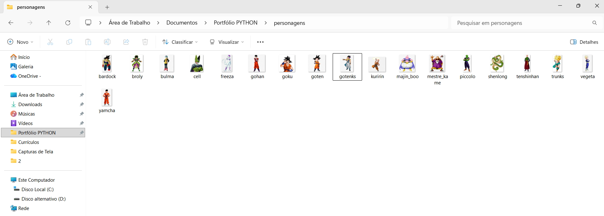

<h1 align="center">🐉 Jogo da Memória — Dragon Ball Z</h1>

<p align="center">
  Jogo da memória desktop com tema Dragon Ball Z, feito em <strong>Python + Tkinter</strong>,<br>
  com interface <strong>responsiva</strong>, barra de ki e cards com imagens dos guerreiros Z.
</p>

<p align="center">
  
  
  
  
</p>

<p align="center">
  
" alt="Tela do Jogo da Memória Dragon Ball Z em execução" width="460">
</p>

---

## 📖 Sobre o projeto

Este projeto nasceu como um jogo da memória simples, com cartas coloridas, e evoluiu para uma aplicação
completa com **tema próprio, interface responsiva e lógica de jogo robusta**.

O objetivo foi praticar, na prática, conceitos importantes de desenvolvimento de interfaces gráficas em Python:
gerenciamento de estado, eventos, layout adaptável a diferentes tamanhos de tela (testado em dois monitores
de tamanhos diferentes) e carregamento de imagens com cache.

## ✨ Funcionalidades

- 🃏 **36 cards** (18 pares) embaralhados a cada partida
- 🐲 **18 personagens** de Dragon Ball Z, com nome e cor de aura própria em cada card
- 🖼️ **Imagens dos personagens** carregadas automaticamente da pasta `personagens/`
- 📐 **Interface responsiva**: cards, imagens e fontes se ajustam ao tamanho da janela
- ⚡ **Barra de KI**: mostra quantas tentativas ainda restam (amarela, laranja e vermelha)
- 🔢 **Placar** com tentativas usadas e pares encontrados
- 🔒 **Bloqueio de cliques** enquanto duas cartas estão sendo comparadas (evita bugs de estado)
- 🔄 **Botão REINICIAR** e reinício automático ao ganhar ou perder
- 🖥️ **Tela cheia** com `F11` (e `Esc` para sair)
- 🛟 **Funciona mesmo sem imagens**: se não houver arquivo, o card mostra o nome do personagem

## 🛠️ Tecnologias

| Tecnologia | Uso |
|---|---|
| **Python 3.8+** | Linguagem principal |
| **Tkinter** (biblioteca padrão) | Interface gráfica, grid layout e eventos |
| **Pillow** (opcional) | Redimensionar as imagens dos personagens conforme a janela |

## 🚀 Como executar

### 1. Clone o repositório

```bash
git clone https://github.com/Darlan-Monteiro/jogo-memoria-dbz.git
cd jogo-memoria-dbz
```

### 2. (Recomendado) Instale o Pillow

O Pillow permite redimensionar as imagens automaticamente. O jogo funciona sem ele, mas as imagens só
aparecem se já estiverem em um tamanho pequeno o bastante para caber no card.

```bash
pip install -r requirements.txt
```

### 3. Adicione as imagens dos personagens

As imagens **não estão incluídas neste repositório** (veja o aviso legal no final deste README).
Coloque suas próprias imagens na pasta `personagens/`, com os nomes abaixo:

```
personagens/goku.png         personagens/yamcha.png
personagens/vegeta.png       personagens/tenshinhan.png
personagens/gohan.png        personagens/bulma.png
personagens/piccolo.png      personagens/gotenks.png
personagens/kuririn.png      personagens/broly.png
personagens/trunks.png       personagens/bardock.png
personagens/goten.png        personagens/shenlong.png
personagens/freeza.png       personagens/cell.png
personagens/majin_boo.png    personagens/mestre_kame.png
```

> 💡 Formatos aceitos: `.png`, `.gif`, `.jpg` e `.jpeg`. Imagens quadradas ou com fundo transparente ficam melhores.
> Sem as imagens, o jogo continua funcionando e mostra apenas o nome do personagem no card.

<p align="center">
  
</p>

### 4. Execute

```bash
python jogo_memoria_dbz.py
```

## 🎮 Como jogar

1. Clique em um card para revelar o personagem.
2. Clique em outro card para tentar formar o par.
3. Pares iguais ficam apagados no tabuleiro; pares diferentes voltam a ficar virados.
4. Encontre os **18 pares** antes que a barra de **KI** acabe (limite de **50 tentativas**).

| Tecla | Ação |
|---|---|
| `F11` | Entrar ou sair da tela cheia |
| `Esc` | Sair da tela cheia |

## 🧠 Como o projeto funciona

### Estado do jogo

Cada card tem um estado (`oculto`, `revelado` ou `combinado`) guardado no dicionário `estados`.
Isso permite **redesenhar qualquer card** a qualquer momento, algo essencial para a responsividade, já
que as imagens e fontes precisam ser recriadas quando a janela muda de tamanho.

### Responsividade

Todas as linhas e colunas do tabuleiro usam `weight=1` e `uniform`, e os botões usam `sticky='nsew'`, então
cada célula cresce por igual. Quando o tabuleiro muda de tamanho, a função `ajustar_tamanho()` recalcula:

- o tamanho dos cards (`tam_card`);
- o tamanho das imagens (`img_px`, 60% do card);
- as fontes do título, do rodapé e dos cards (objetos `tkfont.Font`, que atualizam todos os widgets).

Um *debounce* de 80 ms (`ao_redimensionar`) evita recalcular a cada pixel enquanto a janela é arrastada.

### Principais funções

| Função | O que faz |
|---|---|
| `create_card_grid()` | Duplica e embaralha os índices dos personagens e monta a grade |
| `esconder()` / `revelar()` / `marcar_combinado()` | Controlam a aparência de cada card |
| `card_clicked()` | Trata o clique, controla a seleção e bloqueia o tabuleiro durante a comparação |
| `check_match()` | Compara as duas cartas viradas e atualiza o estado |
| `check_end()` | Verifica vitória ou derrota |
| `update_score()` | Atualiza o placar e a barra de KI |
| `carregar_imagem()` | Carrega e redimensiona as imagens, com cache por tamanho |
| `ajustar_tamanho()` | Recalcula cards, imagens e fontes quando a janela muda |

## 🗂️ Estrutura do repositório

```
jogo-memoria-dbz/
├── jogo_memoria_dbz.py     # código completo do jogo
├── requirements.txt        # dependências (Pillow)
├── personagens/            # coloque aqui as imagens dos personagens
│   └── README.md
├── docs/                   # imagens usadas neste README
│   ├── tela-do-jogo.png
│   └── pasta-personagens.png
├── LICENSE
└── README.md
```

## ⚙️ Personalização

As principais configurações ficam no topo de `jogo_memoria_dbz.py`:

| Constante | Descrição |
|---|---|
| `NUM_ROWS` / `NUM_COLS` | Tamanho do tabuleiro (a quantidade de cards deve ser par) |
| `MAX_ATTEMPTS` | Número máximo de tentativas |
| `DELAY_MS` | Tempo que as cartas erradas ficam à mostra |
| `TELA_PERC_ALTURA` | Percentual da altura da tela usado ao abrir a janela |
| `MIN_CARD`, `MIN_LARGURA`, `MIN_ALTURA` | Limites mínimos de tamanho |
| `PERSONAGENS` | Lista de nomes, arquivos e cores dos cards |

> Para mudar o tamanho do tabuleiro, ajuste `NUM_ROWS` e `NUM_COLS` e mantenha o número de pares igual à
> quantidade de personagens em `PERSONAGENS`.

## 🗺️ Próximos passos

- [ ] Níveis de dificuldade (tabuleiros 4x4, 6x6 e 8x8)
- [ ] Cronômetro e recorde de melhor pontuação
- [ ] Efeitos sonoros
- [ ] Modo para dois jogadores
- [ ] Empacotar em executável (`.exe`) com PyInstaller

## ⚠️ Aviso legal

Este é um **projeto de fã, criado para fins educacionais e de portfólio, sem fins lucrativos**.
Dragon Ball Z e seus personagens são propriedade de seus respectivos detentores de direitos
(Akira Toriyama, Bird Studio, Shueisha, Toei Animation e outros). Este repositório não é afiliado
nem endossado por eles e **não distribui as imagens dos personagens**: cada pessoa deve usar suas próprias imagens
localmente. O código-fonte está disponível sob a licença MIT.

## 👤 Autor

**Darlan Monteiro** · Python & SQL Developer

Estudante de Sistemas de Informação e Análise e Desenvolvimento de Sistemas, apaixonado por dados.
Meu foco é unir estatística e programação para resolver problemas reais com Inteligência Artificial.

Este jogo é um projeto de estudo (e de fã!) em que pratiquei interface gráfica, gerenciamento de estado,
layout responsivo e boas práticas para organizar um repositório.

[](https://www.linkedin.com/in/SEU-PERFIL/)
[](https://github.com/Darlan-Monteiro)

Se o projeto te ajudou ou te divertiu, deixe uma ⭐ no repositório!

## 📄 Licença

Distribuído sob a licença MIT. Veja o arquivo [LICENSE](LICENSE) para mais detalhes.
